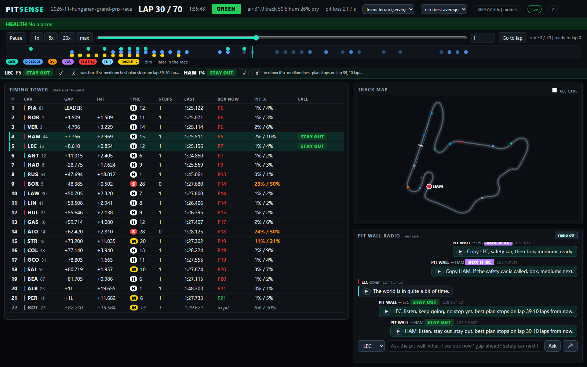
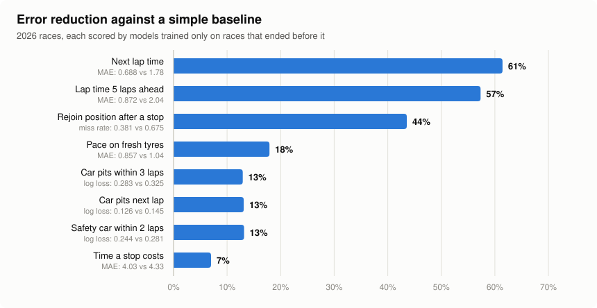
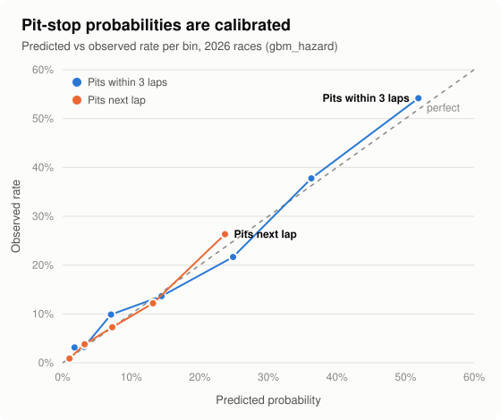
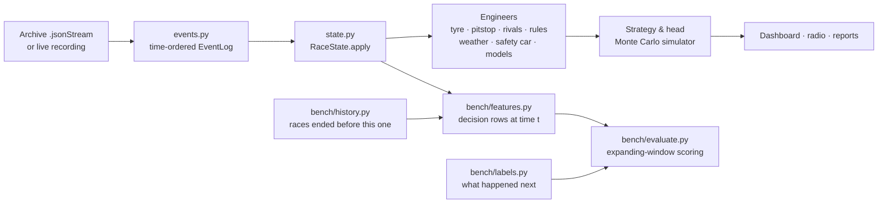

<div align="center">

# PitSense

**A virtual Formula 1 pit wall built on the public timing feed.**

One engineer per role on a race-strategy team (tyres, pit stops, rivals, weather, safety car, strategy and radio),
each scored against what actually happened, without ever seeing the future.

[](https://github.com/vedantsomani/pitsense/actions/workflows/ci.yml)


[Quick start](#quick-start) · [Dashboard](#the-dashboard) · [Results](#results) · [How it works](#how-it-works) · [Docs](#documentation)



<sub>Replay of the 2026 Hungarian GP, lap 30, from Ferrari's pit wall: timing tower with pit-now projections, track map, and the radio panel with live calls.</sub>

</div>

---

## What it does

- **Rebuilds every race from the raw feed.** Every Grand Prix from 2018 to 2026, validated lap by lap against FastF1.
- **Makes the calls a strategist makes:** BOX / STAY OUT with reasons, Plan A / Plan B, undercut threats, safety-car alerts, slick/inter crossover.
- **Runs live or as a replay:** a browser dashboard with timing tower, track map, radio and a question box ("what if we box now?").
- **Talks on the radio.** Calls written by a fine-tuned small language model, fact-checked by a guard, and spoken offline by Piper.
- **Proves it never cheats.** Every model for a race is trained only on races that finished before it, and a corrupted-future test checks that nothing leaks.

## The engineers

| Engineer | Job | Doc |
|---|---|---|
| Data | rebuilds the race from the raw feed; every Grand Prix 2018–2026, validated against FastF1 | [data](docs/data.md) |
| Tyres & pace | fuel-corrected pace, wear, tyre-cliff risk, pace on fresh tyres | [tyre](docs/engineers/tyre.md) |
| Pit stops | what a stop costs now (green / SC / VSC), where the car rejoins | [pitstop](docs/engineers/pitstop.md) |
| Rivals | who pits when, undercut threats and chances | [rivals](docs/engineers/rivals.md) |
| Rules | race control as structured facts: penalties, SC phases, the compound rule | [rules](docs/engineers/rules.md) |
| Weather | rain in the next 10 minutes, slick / intermediate crossover | [weather](docs/engineers/weather.md) |
| Models | cross-race models served live, identical to the benchmark | [models](docs/models.md) |
| Strategy & head | Monte Carlo race simulation, Plan A / B, BOX / STAY OUT calls with reasons | [strategy](docs/engineers/strategy.md) |
| Voice | fine-tuned SmolLM2 plus our own small model: radio calls and briefs, fact-checked, spoken by Piper | [voice](docs/engineers/voice.md) |
| Mechanics | telemetry, radio and chief mechanic: power loss, slowdowns, problem reports | [mechanics](docs/engineers/mechanics.md) |
| Safety car | calibrated SC / VSC probability for the next 2 laps, "safety car likely" alert | [safetycar](docs/engineers/safetycar.md) |
| Rival radio | other teams' radio as alerts: "box box", "Plan B", "tyres are gone" | [rivalradio](docs/engineers/rivalradio.md) |
| Weekend | tyre sets left from FP/quali; qualifying pit wall (cut line, send-now calls) | [weekend](docs/engineers/weekend.md) |

## At a glance

Every number is a backtest on the 2026 races, each scored with models trained only on races that finished before it.

<p align="center">
  <picture>
    <source media="(prefers-color-scheme: dark)" srcset="docs/images/benchmark-dark.svg">
    
  </picture>
</p>

<table>
<tr>
<td width="55%">
<picture>
  <source media="(prefers-color-scheme: dark)" srcset="docs/images/calibration-dark.svg">
  
</picture>
</td>
<td>

**Probabilities you can act on.** When the pit model says 25%, cars pit about a quarter of the time, so a strategist can treat its numbers as odds, not scores.

**Reconstruction you can trust.** Across 39 races and 43,856 laps of 2025–26, lap times match FastF1 to the millisecond on **99.998%** of laps.

**Honest about the weak spot.** Box-call timing is still the hardest part; run it in shadow mode (`pitsense shadow-score`) before trusting it. Full tables in [Results](#results).

</td>
</tr>
</table>

## Quick start

Requires Python 3.10+ (3.12 recommended).

```bash
git clone https://github.com/vedantsomani/pitsense.git
cd pitsense
python -m venv .venv && source .venv/bin/activate      # Windows: .venv\Scripts\Activate.ps1
pip install -e ".[dev]"
pytest -q                                              # real-race tests skip until data is downloaded
```

<details>
<summary><b>Windows (PowerShell) notes</b></summary>

```powershell
Set-ExecutionPolicy -Scope CurrentUser RemoteSigned   # once: lets PowerShell run the activate script
py -3.12 -m venv .venv
.venv\Scripts\Activate.ps1                            # prompt now starts with (.venv)
python -m pip install -e ".[dev]"
```

If you can't change the execution policy, skip activation and put `.venv\Scripts\` in front of commands, e.g. `.venv\Scripts\pitsense bench run`. Without either, `pip` installs into your global Python instead of the project's environment. `Get-Command pitsense` shows which executable PowerShell will run.

An editable install uses this checkout's `data` folder wherever it is launched from. Override it with `pitsense --data <folder> ...` or `PITSENSE_DATA`. A packaged install defaults to `./data`.

</details>

Then download races and build the benchmark:

```bash
pitsense bench build          # downloads 2025+2026 races (~250 MB) and builds the benchmark (~2 min)
pitsense bench run            # leaderboard -> reports/leaderboard.md
pitsense replay --year 2026 --race hungary --lap 16
pitsense leakcheck --year 2026 --race italian --cuts 3
pitsense validate --year 2026 # compare our lap reconstruction with FastF1 (slow: downloads via FastF1)
```

`replay` prints the timing tower using only data up to the moment the leader finished that lap, with a **pit-now projection** for every car: where it would rejoin if it pitted now.

```
Lap 17/70   track: GREEN   pit loss now ≈ 19.9 s (prior circuit:2025-14-hungarian-grand-prix-race, 3 stops measured this race)

 P  CAR  GAP        INT       TYRE   STOPS  LAST       PIT NOW →
 1  NOR  +0.000     --        M 15     0    1:25.613   P1
 3  LEC  +7.386     +6.426    S 18     0    1:26.066   P8
 6  VER  +24.438    +5.616    H  1     1    1:43.352   P13
```

## The dashboard

No Node or build step: the dashboard ships with the package and is served by `pitsense pitwall` (alias `pitsense serve`).

```bash
pitsense pitwall --year 2026 --race hungary --speed 20 --team ferrari       # replay with the dashboard
pitsense pitwall --live --team ferrari                                      # live race (F1 TV sign-in)
pitsense pitwall --live --team ferrari --host 0.0.0.0 --token secret        # also open it on a phone on your Wi-Fi
pitsense pitwall --year 2026 --race hungary --session qualifying            # qualifying pit wall
pitsense pitwall --year 2026 --race hungary --team ferrari --risk protect   # rank plans by their downside
pitsense briefing --year 2026 --race bahrain --team ferrari                 # pre-race strategy briefing (HTML)
pitsense report --year 2026 --race bahrain --team ferrari                   # post-race report: every call graded
pitsense calibrate                                                          # refit calibrated call confidence (as-of)
```

Open `http://127.0.0.1:8765/`. Tabs: Tower, Map, Radio, Team, Strategy, Alerts, Season, Analysis.

- **Timing tower and track map** with pit-now projections and pit probabilities for every car.
- **Calls with Plan A / B.** Each call shows what it changed from and why, carries a confidence calibrated on earlier races, and can be accepted or rejected with a reason.
- **Radio panel.** Real driver radio is transcribed by Whisper; the pit wall's calls are written by the fine-tuned voice model and spoken by Piper.
- **Ask the pit wall.** Type or hold-to-talk: "what if we box now?", "what if the safety car comes next lap?", "box now for inters?" The race simulator answers (the wet simulator when it is wet).
- **Grading.** `pitsense shadow-score` grades the calls and the operator's answers after the race.

Archive replays download missing timing and telemetry streams for the map and driver panels, reusing cached files:

```bash
pitsense fetch --year 2026 --race japan --telemetry      # timing + CarData/Position for the map, telemetry and coach
pitsense standings --year 2026                           # season results for the championship panel
pitsense serve --year 2026 --race japan --speed 8 --team ferrari
```

<details>
<summary><b>Recording a live session</b></summary>

```bash
pitsense record --out data/live/race.jsonl --minutes 150   # all topics; --topics to restrict
pitsense pitwall --live --team ferrari                     # ... or record and follow in one go
```

- Start about 15 minutes before lights out. It prints a status line every minute and stops after `--minutes`, or press Ctrl+C. Dry-run it in a practice or qualifying session first.
- **F1 TV sign-in:** the first time, FastF1 prints a link to its sign-in helper. Log in with an F1 account that has F1 TV Access, Pro or Premium; the token is stored locally until it expires.
- **Without F1 TV:** add `--no-auth`. Since the 2025 Dutch GP, car positions and pit-stop times need the login, so those fields will be missing.
- **Replay the recording:** `pitsense replay --file data/live/race.jsonl --lap 20`.
- **Fallback:** FastF1's own recorder (`python -m fastf1.livetiming save race.txt`), then `pitsense replay --fastf1-file race.txt`.
- **After the race:** `pitsense fetch --year 2026` downloads the complete archived version, and `pitsense bench build` adds it to the benchmark.

</details>

## How it works



The reducer (`state.py`) is the only way state changes, and it is deterministic. Features read the state at time *t*; labels read the future and are never imported by features.

**Rules that keep it honest**

1. **The reducer only sees the past.** `EventLog.until(t)` is the past at `t`. The reducer only moves forward, and a decision row is written only after every message with that timestamp has been applied.
2. **No end-of-session snapshots.** The archive's `Topic.json` files hold the final state of the session (the future), so PitSense never reads them.
3. **Raw stream, not FastF1's tables.** FastF1 builds its `Laps` table after the session, using lap deletions from later messages, laps it fills in itself, and a cross-lap accuracy check. PitSense rebuilds the race from the raw stream instead.
4. **Training cutoff.** For race R, priors and models use only races that finished before R started (`HistoryStore.asof`, `assert_trained_before`).
5. **Corrupted-future test** (`pitsense leakcheck`). Rebuild every row with the future deleted (`truncate`) or shuffled (`scramble`). Rows before the cut must not change, including a hash of the live state. A unit test plants a classic leak (a row keeping a live reference to a growing list) and checks that the test catches it.

<details>
<summary><b>Quirks of the feed that the reducer handles</b></summary>

- **Repeated values are omitted.** A lap time identical to the previous one isn't re-sent, so PitSense assumes it unchanged and overrides it if a value arrives.
- **Stint records can be placeholders.** Records flagged "tyres not changed" (pit-lane starts, stops without a tyre change) don't count as a new set. A record whose compound differs from the previous set does count.
- **Tyre changes are sometimes confirmed late.** The feed can confirm a change 1–8 laps afterwards. The current stint is then re-anchored to the stop where it happened. Laps recorded earlier keep what was known at the time.
- **Tyre age is derived.** It's computed from the stint start, because the feed's own lap counter arrives about 2 s after the line and sometimes freezes mid-race.
- **Red-flag pit-lane entries aren't stops.** Everyone goes in and tyres are changed for free, so they're excluded from the labels.

</details>

## Validation against FastF1

All races 2018–2026 are validated per season in [docs/data.md](docs/data.md). For 2025–26 (39 races, 43,856 laps):

| Check | Match |
|---|---|
| Lap time identical to the millisecond | 99.998% |
| In-lap / out-lap flags | 100% / 100% |
| Position at the line | 99.46% |
| Compound | 99.66% |
| Tyre age | 97.64% |

The remaining differences come from timing, not parsing. **Position:** we record the tower *at the moment of crossing*, when a car in the pit lane may already be shown behind; FastF1 re-orders by crossing times after the session. **Tyre age:** FastF1 uses the final, corrected stint data; we use what had been published by then. In one race (Miami 2025) FastF1 itself mislabels stints because the feed had a gap, and our derived age matches the feed's own lap counter there. Full per-race output: `reports/validation.txt`.

## Results

Every number in this section is generated: `pitsense results --readme` writes `reports/results.md` / `results.json` (each table tagged with data version, config, training cutoff and git commit) and replaces the block below. Method: [docs/evaluation.md](docs/evaluation.md).

<!-- results:begin -->
<!-- generated by `pitsense results --readme` from reports/results.md; do not edit by hand -->

Generated by `pitsense results` (2026-10-21T05:22:39Z). Test year: **2026**; every model and setting was trained or tuned without it (hold-out audit below). Each table names the run it came from.

Data versions in this report: ef5f71a5323d; configs: efdd6e6d50e4

### Benchmark tasks

| Task | Model | Score | Baseline | n |
|---|---|---|---|---|
| Car pits next lap | `gbm_hazard` | log_loss 0.126, auc 0.791 | base_rate: log_loss 0.145 | 17218 |
| Car pits within 3 laps | `gbm_hazard` | log_loss 0.283, auc 0.760 | base_rate: log_loss 0.325 | 17218 |
| Rejoin position after a stop | `pitstop_rule` | exact 0.619, within_1 0.898 | no_change: exact 0.325, within_1 0.521 | 606 |
| Time a stop costs, s | `v01_prior_shrink` | mae 4.026 | pitstop_loss_gbm: mae 4.329 | 467 |
| Next lap time, s | `next_lap_gbm` | mae 0.688 | stint_median: mae 1.784 | 14263 |
| Lap time 5 laps ahead, s | `lap5_gbm` | mae 0.872 | stint_median: mae 2.044 | 9438 |
| Tyre cliff within 3 laps | `cliff_gbm` | auc 0.806, log_loss 0.126 | base_rate: auc 0.410 | 9195 |
| Pace on fresh tyres, s | `fresh_gbm` | mae 0.857 | stint_best: mae 1.044 | 303 |
| Undercut by the car behind within 5 laps | `rivals_threat` | auc 0.807 | base_rate: auc 0.491 | 14678 |
| Rain within 10 minutes | `gbm_weather [all]` | log_loss 0.072 | rc_risk_raw [wet_races]: log_loss 0.955 | 17373 |
| Safety car within 2 laps | `engineer` | log_loss 0.244 | gbm_signals: log_loss 0.281 | 896 |
| Laps until next stop | `survival_hz` | c_index 0.739 | base_hazard: c_index 0.607 | 17218 |

Runs: benchmark: data 40 races #ef5f71a5323d | config #efdd6e6d50e4 | cutoff: expanding window: each 2026 race scored by models trained on races that ended before it (min 10 earlier races); strategy tasks: models bundle trained before the first 2026 race | git 521b399954+dirty


### Hold-out audit

| Component | Tuned / trained on | Check | Test year untouched |
|---|---|---|---|
| benchmark models (all tasks) | races that ended before each test race | automatic (evaluate._splits on a synthetic calendar; fit_predict asserts the cutoff on every fit) | yes |
| models bundle for the pit wall replays | races ended before 2025-12-07 | automatic (train_end_utc < first 2026 race start) | yes |
| voice (scratch model, LoRA fine-tune) | races before 2026 | automatic (voice.synth.split_races) | yes |
| strategy simulator + head thresholds (SETTINGS, sim.PARAMS) | 2025 | declared (docs/engineers/strategy.md) | yes |
| wet engine thresholds | 2018-2024 wet races | declared (docs/engineers/strategy.md) | yes |
| safety-car engineer | 2025 (--select-year) | declared (docs/engineers/safetycar.md) | yes |
| qualifying model | 2025 sessions | declared (bench/quali.py) | yes |
| benchmark model settings | 2025 | declared (README / docs/models.md) | yes |
| decision value / fair call scoring | nothing (windows and options fixed before scoring) | declared (bench/decision.py, bench/callscore.py) | yes |

<!-- results:end -->

Every engineer value goes into the benchmark rows, so the corrupted-future check (`pitsense leakcheck`) covers all of them. The simulator and calls have their own check (`pitsense strategy-leakcheck`). Full tables are in each engineer's doc.

## Add your own model

Implement `fit(train_df, target)` and `predict(test_df)` (see `src/pitsense/bench/models.py`), add the class to `PIT_MODELS` or `REJOIN_MODELS`, then run `pitsense bench run`. Feature columns are listed in `NUMERIC_FEATURES` in `bench/features.py`. Labels start with `y_`.

## Known limitations

- **Live: one real race so far.** The recorder ran through the 2026 Bahrain GP with an F1 TV login (74k messages, about 37 reconnects) and the race rebuilds fully from it. The pit wall made no calls that day because of a wet-start bug, since fixed.
- **Box calls are the weakest part.** Precision and recall differ a lot between races (per-circuit table in `reports/results.md`), and most stops under a safety car can't be foreseen a lap ahead. Matching what the team did is scored separately from decision value, which is only a simulator estimate.
- **Wet strategy is weak.** The wet engine makes tyre-class calls (BOX for INTERS / SLICKS), but most are early or late, and it ignores rivals and traffic. See [docs/engineers/strategy.md](docs/engineers/strategy.md) for the 2025–26 study.
- **Public timing only:** no fuel loads, tyre temperatures or car telemetry. PitSense is strongest on rivals, whom teams also see only through timing.
- **Voice.** The fine-tuned SmolLM2-360M writes the radio calls, fact-checked by a guard. Piper (British voice) speaks them offline; each message takes about 1 s on the GPU.
- **The simulator is simplified:** at most one SC and one VSC per simulated future, no red-flag restarts, no lapped traffic or blue flags, a fixed 6 s added to every stop for warm-up and traffic, and rivals that don't react to our stops.

## Roadmap

1. **Shadow mode at real races.** Record live, run `pitsense pitwall --follow`, then publish `pitsense shadow-score` after each race.
2. **Better box calls.** Fix the simulator's stop-timing bias and calibrate opponents' stops with the models engineer.
3. **A wet-weather strategy model.**
4. **Open the benchmark.** Publish a data card and score other open strategy engines.

The full plan, including the paper on physics-informed tyre-state estimation, is in [docs/RESEARCH_PLAN.md](docs/RESEARCH_PLAN.md).

## Documentation

| Doc | What's in it |
|---|---|
| [docs/pitwall.md](docs/pitwall.md) | How a team uses it from day one |
| [docs/ENGINEERING.md](docs/ENGINEERING.md) | Architecture, contracts, and the rules every change follows |
| [docs/data.md](docs/data.md) | The data layer and per-season validation |
| [docs/models.md](docs/models.md) | Cross-race models and their settings |
| [docs/evaluation.md](docs/evaluation.md) | Benchmark method and hold-out audit |
| [docs/feeds.md](docs/feeds.md) | Feeds beyond timing |
| [docs/engineers/](docs/engineers/) | One doc per engineer, with its benchmark tables |
| [docs/ROADMAP.md](docs/ROADMAP.md) · [docs/RESEARCH_PLAN.md](docs/RESEARCH_PLAN.md) | What's next |

## Project layout

```
src/pitsense/
  archive, events, merge, state      raw feed -> deterministic race state
  asof, pitloss, validate, live      as-of stores, pit loss, FastF1 check, recorder
  pitwall/                           engineers (tyre, pitstop, rivals, rules, weather, models,
                                     strategy, head), PitWall orchestrator, runtime (live / replay)
  web/                               dashboard (standard library, offline)
  bench/                             features, labels, tasks, models, evaluation, leak check
  voice/                             radio / brief composer, own SLM, fine-tune, guard, TTS
  modelstore.py, registry.py, cli.py
docs/                                handbook, data, models, pit wall, one doc per engineer
reports/                             generated leaderboards, results and validation output
tests/                               synthetic-feed tests, leak tests, parity tests
```

## Contributors

<table>
  <tr>
    <td align="center"><a href="https://github.com/vedantsomani"><br><sub><b>Vedant Somani</b></sub></a></td>
    <td align="center"><a href="https://github.com/Aa-yu-shi"><br><sub><b>Aa-yu-shi</b></sub></a></td>
  </tr>
</table>

## Data and terms

- **Unofficial.** PitSense isn't associated with Formula 1. F1, FORMULA ONE and related marks belong to Formula One Licensing B.V.
- **No timing data in the repo.** Timing data comes from F1's live-timing service and stays under its terms, so the repository ships none (`data/` is gitignored).
- **Publish predictions, not the raw feed.** Check the F1 TV and OpenF1 terms before any commercial use.
